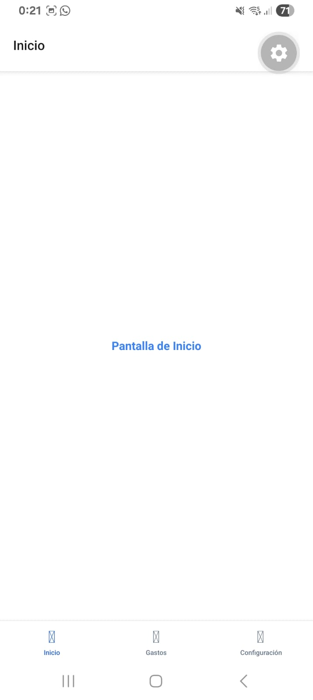
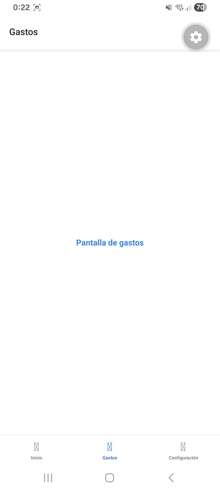
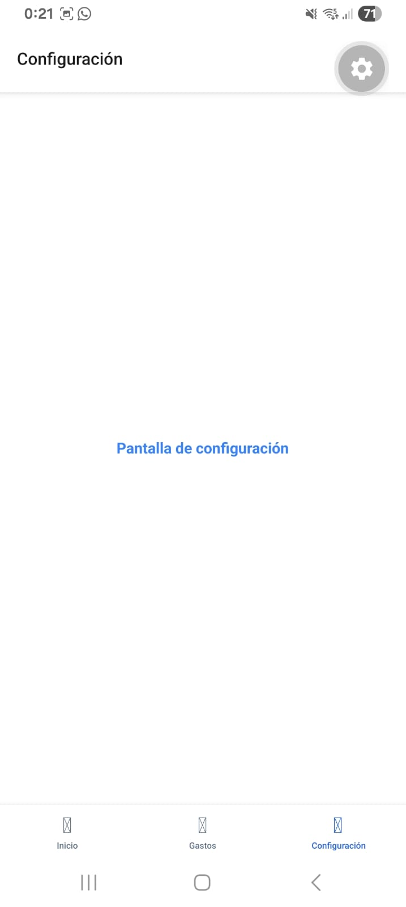
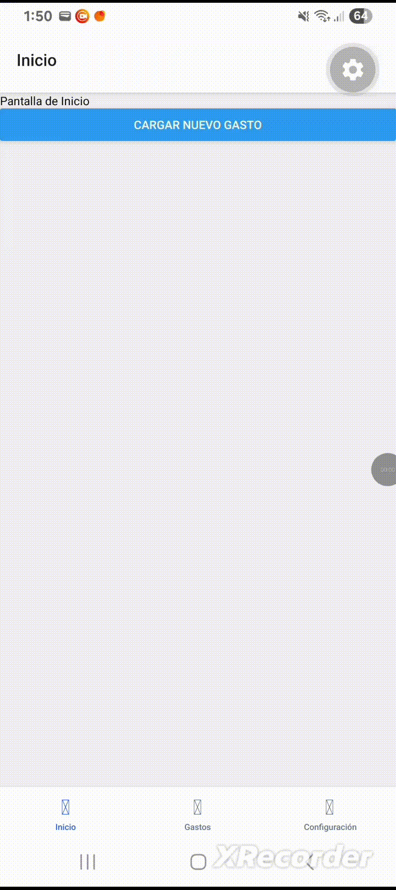

# ExpenseTracker

## Como instalar las dependencias
- pnpm install

## Como ejecutar el proyecto
- pnpx expo start
- Una vez ejecutado el proyecto, podemos probar la aplicación descargando en la playstore ExpoGo.
- Cuando estemos dentro de ExpoGo, en la computadora en la que corrimos la app podemos escanear un QR para probar en vivo los cambios e interactuar con la aplicación, cabe destacar que el teléfono debe estar conectado a la misma red wifi que la computadora que hostea la app.

## Sprint 6: Manejo de navegación
- Se implementó el tab navigator con 3 tabs (Inicio, Gastos, Configuración)
- Demo de NavigationContainer con los TabScreens, StackNavigator y BottomNavigationBar

#### Pantalla de inicio, gastos y configuración como TabScreens
- Pantalla de inicio

- Pantalla de gastos

- Pantalla de configuración

#### Demostración de StackNavigator y Navegación Anidada
- Se integró el StackNavigator junto con el TabNavigator para permitir navegación fluida entre pantallas y apertura de modales.
- Permite acceder al detalle de un gasto puntual y abrir la pantalla modal para registrar nuevos gastos.

- Demo del flujo de navegación y modal
