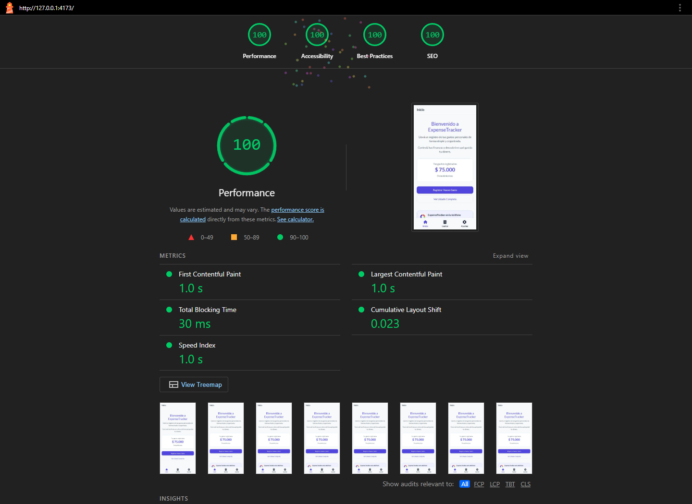

# ExpenseTracker PWA

Versión web del Sprint 2, independiente de la aplicación Expo de la raíz.

Requiere Node.js 22.12 o superior y pnpm 12.

Desde esta carpeta:

```sh
pnpm install
pnpm dev
pnpm lint
pnpm typecheck
pnpm build
pnpm preview
```

Para probar la interfaz desde un teléfono en la misma red: `pnpm dev --host`.
La instalación y el Service Worker en un teléfono requieren HTTPS.


## Estructura y migración

`src/pages` contiene pantallas; `components`, piezas reutilizables; `router` y `layouts` reemplazan stack y tabs. `hooks` contiene instalación y acceso al modal; `data` mantiene los tres gastos del Sprint 1, ampliados con fechas y notas ficticias; `styles` contiene CSS. El estado del modal vive en MainLayout, sin dependencias de estado global.

Se conservan Lato, paleta, iconos de navegación y estilo del proyecto native. Los iconos de instalación derivan del nuevo `src/assets/icon.png` de Expo. Las fuentes se sirven localmente para funcionar offline.

El formulario confirma el envío en pantalla, pero no persiste gastos. Ajustes conserva el placeholder de la versión native.

## Producción y offline

Ejecutar `pnpm build` y `pnpm preview --host 127.0.0.1`. En localhost el navegador permite Service Workers. El worker no se activa en `pnpm dev`.

1. Abrir la app online una vez y esperar al Service Worker activo en Application → Service Workers.
2. Confirmar HTML, JS, CSS, fuentes e iconos en Cache Storage.
3. Activar Offline y recargar `/expenses/2`. Debe verse Combustible y permitir navegar a Inicio, Gastos y Ajustes.
4. Comprobar `/expenses/no-existe` y volver al listado.

El precache cubre los recursos estáticos; no hay API ni almacenamiento de gastos. Sólo existe `public/manifest.json`: el plugin usa `manifest: false`.

## Publicación HTTPS

Elegir `expense-tracker-pwa` como directorio raíz en Vercel o Netlify. Build: `pnpm build`; salida: `dist`. Se incluyen reglas SPA para que `/expenses/:id` funcione al recargar y el worker se actualice sin caché HTTP persistente.

La publicación y su URL HTTPS quedan pendientes: este trabajo se entrega sin commits ni push. No se desplegó una versión distinta del código entregado.

En Android/Chrome el botón Instalar App aparece cuando el navegador ofrece la instalación. En iOS se muestran instrucciones de Safari, salvo que ya esté abierta desde la pantalla de inicio. La disponibilidad depende del navegador y de que la app todavía no esté instalada.

## Validación manual en teléfono (pendiente)

- Android: instalar desde HTTPS, abrir en standalone y comprobar nombre e icono.
- iOS: Compartir → Agregar a la pantalla de inicio; el banner debe desaparecer al abrir la app instalada.
- Abrir el formulario con teclado virtual, completar monto con coma, guardar, cancelar y volver a abrir.
- Comprobar navegación atrás del sistema y áreas seguras.

## Lighthouse

El informe y la captura de la auditoría local se guardan en `docs/` cuando se ejecuta la verificación. La auditoría del despliegue HTTPS y la instalación en un teléfono real siguen pendientes.


Auditoría local Mobile en Microsoft Edge (Chromium), 2026-10-30. Rendimiento: 100; accesibilidad: 100; buenas prácticas: 100; SEO: 100. Los resultados corresponden a localhost y no verifican la instalación en un dispositivo real.



[Informe completo](docs/lighthouse-mobile.report.html) · [Resultado JSON](docs/lighthouse-mobile.report.json) · [Pruebas en navegador](docs/browser-checks.json)
